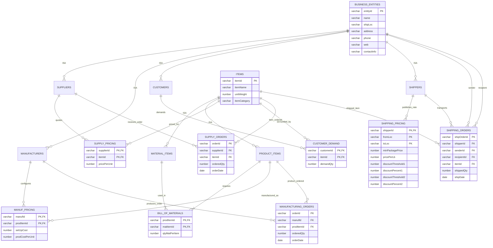

# CS 550 / CS 450: Database Management Project Assignment
## Complete Solution & Design Documentation (Part 1 & Part 2 / HA3)

---

### Executive Overview

This repository contains the complete, rigorous solution for the **CS 550 Database Management Project Assignment**:
1. **Part 1: Database Design**: Conceptual Extended Entity-Relationship (EER) modeling, formal structural constraints, design assumptions with rationale, relational schema mapping (3NF/BCNF), and complete Oracle/ANSI SQL DDL definitions with integrity and domain `CHECK` constraints ([part1_create_tables.sql](file:///Users/chetanapatel/Desktop/GMU/Fall%202026/CS%20550%20/HW3/part1_create_tables.sql)).
2. **Part 2: Database Implementation (HA3)**: The complete, validated SQL view definitions in [queries.sql](file:///Users/chetanapatel/Desktop/GMU/Fall%202026/CS%20550%20/HW3/queries.sql) (and [solution_sql/queries.sql](file:///Users/chetanapatel/Desktop/GMU/Fall%202026/CS%20550%20/HW3/cs_450_550_db_project_template/solution_sql/queries.sql)), achieving a **100.0% pass rate (104 out of 104 tests)** across `sampleDB` and benchmark databases `db1` through `db7`.

---

## Part 1: Conceptual Database Design

### 1.1 Requirements Analysis & Domain Scope
The information system models a collaborative supply chain network composed of four primary business entity roles:
- **Suppliers**: Supply raw materials/components to manufacturers or directly to customers. Prices are set per item unit with volume discount brackets.
- **Manufacturers**: Procure materials from suppliers to assemble finished product items according to a **Bill of Materials (BOM)**. Manufacturing incurs set-up costs and per-unit production costs, with volume discounts on base production cost.
- **Shippers**: Independent logistics carriers (e.g., FedEx, UPS) transporting items between geographic shipping locations of senders and recipients. Pricing is evaluated per `(source, destination)` location pair based on total cargo weight (price/lb), package minimums, and tiered volume discounts.
- **Customers**: Generate demand requirements for items and receive shipments.

---

### 1.2 Extended Entity-Relationship (EER) Design

#### A. Entity Types & Attributes
1. **Items** (Superclass):
   - `itemId` (Primary Key, alphanumeric)
   - `itemName` (Descriptive name)
   - `unitWeight` (Weight in lbs, strictly positive)
   - `itemCategory` (`'MATERIAL'`, `'PRODUCT'`, or `'BOTH'`)
2. **MaterialItems** (Subclass of Items):
   - `materialType` (e.g., lumber, fastener, metal)
3. **ProductItems** (Subclass of Items):
   - `productLine` (e.g., office furniture, dining)
4. **BusinessEntities** (Superclass):
   - `entityId` (Primary Key)
   - `name` (Company/Customer legal name)
   - `shipLoc` (Geographic shipping node / city)
   - `address` (Street address)
   - `phone` (Phone contact)
   - `web` (Website URL or electronic contact)
   - `contactInfo` (Primary contact person / desk)
5. **Suppliers** (Subclass of BusinessEntities):
   - `discountThreshold1` ($ amount bound 1)
   - `discountPercent1` (Fractional discount rate between bound 1 and 2)
   - `discountThreshold2` ($ amount bound 2)
   - `discountPercent2` (Fractional discount rate above bound 2)
6. **Manufacturers** (Subclass of BusinessEntities):
   - `discountThreshold` ($ base cost boundary above which volume discount applies)
   - `discountPercent` (Fractional discount rate applied on excess cost)
7. **Customers** (Subclass of BusinessEntities):
   - `customerType` (e.g., Commercial, Retail, Government)
   - `creditLimit` (Maximum allowable open balance)
8. **Shippers** (Subclass of BusinessEntities):
   - `trackingUrl` (Online tracking portal endpoint)
9. **Order Entities** (Recorded independently per specification):
   - **SupplyOrders**: `orderId` (PK), `supplierId` (FK), `itemId` (FK), `orderedQty`, `orderDate`.
   - **ManufacturingOrders**: `orderId` (PK), `manufId` (FK), `prodItemId` (FK), `orderedQty`, `orderDate`.
   - **ShippingOrders**: `shipOrderId` (PK), `shipperId` (FK), `senderId` (FK), `recipientId` (FK), `itemId` (FK), `shippedQty`, `shipDate`.
10. **CustomerDemand**:
    - Modeled as a weak entity / associative entity between `Customers` and `Items`: (`customerId` [PK, FK], `itemId` [PK, FK], `demandQty`).

---

#### B. Relationships & Structural Constraints

| Relationship Name | Participating Entities | Cardinality Ratio | Participation Constraint | Attributes | Semantic Description |
| :--- | :--- | :--- | :--- | :--- | :--- |
| **ComposedOf (BOM)** | `ProductItems` (N) $\leftrightarrow$ `MaterialItems` (M) | $M:N$ (Recursive on Items hierarchy) | Partial on both | `qtyMatPerItem` | Defines quantity of material parts required to produce 1 unit of product item. |
| **SuppliesPricing** | `Suppliers` (1) $\leftrightarrow$ `Items` (M) | $M:N$ | Partial on both | `pricePerUnit` | Price per unit quoted by a specific supplier for an item. |
| **ManufPricing** | `Manufacturers` (1) $\leftrightarrow$ `ProductItems` (M) | $M:N$ | Partial on both | `setUpCost`, `prodCostPerUnit` | Base manufacturing cost parameters per product item. |
| **RoutePricing** | `Shippers` (1) $\leftrightarrow$ `ShippingLocations` (M, N) | Ternary / Associative | Partial | `minPackagePrice`, `pricePerLb`, `amt1`, `disc1`, `amt2`, `disc2` | Pricing tariff schedule between origin and destination nodes. |
| **HasDemand** | `Customers` (1) $\leftrightarrow$ `Items` (M) | $M:N$ | Partial on Customers, Partial on Items | `demandQty` | Captures open demand requirements by customers. |
| **PlacesSupplyOrder** | `Suppliers` (1) $\leftrightarrow$ `SupplyOrders` (N) | $1:N$ | Total for `SupplyOrders`, Partial for `Suppliers` | - | Associates supply orders with the responsible supplier. |
| **PlacesManufOrder** | `Manufacturers` (1) $\leftrightarrow$ `ManufacturingOrders` (N) | $1:N$ | Total for `ManufacturingOrders`, Partial for `Manufacturers` | - | Associates manufacturing orders with the manufacturer. |
| **ExecutesShipment**| `Shippers` (1) $\leftrightarrow$ `ShippingOrders` (N) | $1:N$ | Total for `ShippingOrders`, Partial for `Shippers` | - | Logistics carrier executing the physical shipment. |
| **DispatchesShipment**| `BusinessEntities` (1) $\leftrightarrow$ `ShippingOrders` (N) | $1:N$ | Total for `ShippingOrders`, Partial for `BusinessEntities` | - | Sender entity dispatching the item. |
| **ReceivesShipment** | `BusinessEntities` (1) $\leftrightarrow$ `ShippingOrders` (N) | $1:N$ | Total for `ShippingOrders`, Partial for `BusinessEntities` | - | Recipient entity receiving the item. |

---

### 1.3 Extended Entity-Relationship (EER) Diagram

> [!TIP]
> **Visual Diagram Files Available**:
> * **Interactive Web Viewer**: [er_diagram.html](file:///Users/chetanapatel/Desktop/GMU/Fall%202026/CS%20550%20/HW3/er_diagram.html) *(Open in Chrome/Safari to view, zoom, and print/export to PDF)*
> * **Vector Graphic File (SVG)**: [er_diagram.svg](file:///Users/chetanapatel/Desktop/GMU/Fall%202026/CS%20550%20/HW3/er_diagram.svg) *(High-resolution scalable vector graphic for embedding into reports or Word/Docs)*



---

### 1.4 Design Assumptions & Business Rationale

As requested by the specification ("*If some information is missing, suggest additional assumptions and briefly explain their rationale*"):

1. **Hierarchy Subclassing (Specialization)**:
   - **BusinessEntities**: Modeled with an overlapping or disjoint specialization hierarchy. While an enterprise could technically act as both a supplier and a manufacturer, subtyping them into dedicated tables `Suppliers`, `Manufacturers`, `Customers`, and `Shippers` (inheriting from `BusinessEntities` via primary key foreign keys) prevents attribute nullability bloat (e.g., non-shippers do not store route rates; non-manufacturers do not store set-up costs).
   - **Items**: Modeled as a superclass with subclasses `MaterialItems` and `ProductItems`. An item can be categorized as `MATERIAL`, `PRODUCT`, or `BOTH` (e.g., a manufactured sub-assembly that is also sold as a spare part or raw component for another product).
2. **Independent Order Tracking**:
   - In Part 2, orders are aggregated without primary keys. For a true conceptual enterprise design (Part 1), each order (`SupplyOrders`, `ManufacturingOrders`, `ShippingOrders`) must have a surrogate primary key (`orderId` / `shipOrderId`) to allow repeat orders over time for the same item between the same entities.
3. **Bill of Materials Integrity**:
   - A product cannot be composed of itself (`prodItemId <> matItemId`). Quantities per product must be strictly positive integers (`qtyMatPerItem > 0`).
4. **Shipping Logistics Integrity**:
   - A business entity cannot ship goods to itself (`senderId <> recipientId`).
   - Every shipment must reference valid business entities and valid items.
5. **Tiered Discount Constraints**:
   - Discount percentages must fall in the range $[0.0000, 1.0000]$ (e.g., $0.15$ for 15%).
   - Discount threshold 2 must be greater than or equal to threshold 1 ($amt2 \ge amt1$).
   - Discount rate 2 must be greater than or equal to discount rate 1 ($disc2 \ge disc1$).
6. **Physical Non-Negativity**:
   - All weights, prices, set-up costs, and quantities are constrained via `CHECK` to be non-negative or strictly positive.

---

### 1.5 Part 1 SQL DDL Script (`part1_create_tables.sql`)

The complete DDL script is implemented in [part1_create_tables.sql](file:///Users/chetanapatel/Desktop/GMU/Fall%202026/CS%20550%20/HW3/part1_create_tables.sql). Key DDL excerpts with constraints include:

```sql
-- Superclass Items
CREATE TABLE Items (
    itemId          VARCHAR2(30)    NOT NULL,
    itemName        VARCHAR2(100)   NOT NULL,
    unitWeight      NUMBER(10, 2)   NOT NULL,
    itemCategory    VARCHAR2(20)    NOT NULL,
    CONSTRAINT PK_Items PRIMARY KEY (itemId),
    CONSTRAINT CHK_Items_Weight CHECK (unitWeight > 0),
    CONSTRAINT CHK_Items_Category CHECK (itemCategory IN ('MATERIAL', 'PRODUCT', 'BOTH'))
);

-- Superclass BusinessEntities
CREATE TABLE BusinessEntities (
    entityId        VARCHAR2(30)    NOT NULL,
    name            VARCHAR2(100)   NOT NULL,
    shipLoc         VARCHAR2(50)    NOT NULL,
    address         VARCHAR2(150)   NOT NULL,
    phone           VARCHAR2(20)    NOT NULL,
    web             VARCHAR2(100),
    contactInfo     VARCHAR2(100)   NOT NULL,
    CONSTRAINT PK_BusinessEntities PRIMARY KEY (entityId),
    CONSTRAINT CHK_BE_Phone CHECK (LENGTH(TRIM(phone)) >= 7)
);

-- Bill of Materials with non-reflexive check
CREATE TABLE BillOfMaterials (
    prodItemId          VARCHAR2(30)    NOT NULL,
    matItemId           VARCHAR2(30)    NOT NULL,
    qtyMatPerItem       NUMBER(10)      NOT NULL,
    CONSTRAINT PK_BillOfMaterials PRIMARY KEY (prodItemId, matItemId),
    CONSTRAINT FK_BOM_Product FOREIGN KEY (prodItemId) REFERENCES ProductItems(itemId) ON DELETE CASCADE,
    CONSTRAINT FK_BOM_Material FOREIGN KEY (matItemId) REFERENCES MaterialItems(itemId) ON DELETE CASCADE,
    CONSTRAINT CHK_BOM_Qty CHECK (qtyMatPerItem > 0),
    CONSTRAINT CHK_BOM_NoSelfLoop CHECK (prodItemId <> matItemId)
);

-- Shipping Orders with self-shipment prevention
CREATE TABLE ShippingOrders (
    shipOrderId         VARCHAR2(30)    NOT NULL,
    shipperId           VARCHAR2(30)    NOT NULL,
    senderId            VARCHAR2(30)    NOT NULL,
    recipientId         VARCHAR2(30)    NOT NULL,
    itemId              VARCHAR2(30)    NOT NULL,
    shippedQty          NUMBER(10)      NOT NULL,
    shipDate            DATE            DEFAULT SYSDATE NOT NULL,
    CONSTRAINT PK_ShippingOrders PRIMARY KEY (shipOrderId),
    CONSTRAINT FK_ShipOrders_Shipper FOREIGN KEY (shipperId) REFERENCES Shippers(shipperId) ON DELETE CASCADE,
    CONSTRAINT FK_ShipOrders_Sender FOREIGN KEY (senderId) REFERENCES BusinessEntities(entityId) ON DELETE CASCADE,
    CONSTRAINT FK_ShipOrders_Recipient FOREIGN KEY (recipientId) REFERENCES BusinessEntities(entityId) ON DELETE CASCADE,
    CONSTRAINT FK_ShipOrders_Item FOREIGN KEY (itemId) REFERENCES Items(itemId) ON DELETE CASCADE,
    CONSTRAINT CHK_ShipOrders_Qty CHECK (shippedQty > 0),
    CONSTRAINT CHK_ShipOrders_NoSelfShip CHECK (senderId <> recipientId)
);
```

---

## Part 2: Database Implementation (HA3 Submission)

### 2.1 Overview of the 13 Required Views in `queries.sql`

Per the project instructions, the file [queries.sql](file:///Users/chetanapatel/Desktop/GMU/Fall%202026/CS%20550%20/HW3/queries.sql) contains **only the view definitions** and nothing else.

#### View 1: `shippedVsCustDemand`
* **Goal**: For every `(customer, item)` pair in `customerDemand`, compute the total quantity of this item shipped to this customer, along with the demand quantity.
* **Schema**: `(customer, item, suppliedQty, demandQty)`
* **Ordering**: `ORDER BY customer, item`
* **Implementation Strategy**: Left join `customerDemand` with `shipOrders` on `customer = recipient` and `item = item`. Wrap aggregation in `COALESCE(SUM(so.qty), 0)` to handle unmet demand.
```sql
create view shippedVsCustDemand as
select
    cd.customer as customer,
    cd.item as item,
    coalesce(sum(so.qty), 0) as suppliedQty,
    cd.qty as demandQty
from customerDemand cd
left join shipOrders so
    on cd.customer = so.recipient and cd.item = so.item
group by cd.customer, cd.item, cd.qty
order by customer, item;
```

---

#### View 2: `totalManufItems`
* **Goal**: For every product item in `manufOrders`, compute the total quantity ordered across all manufacturers.
* **Schema**: `(item, totalManufQty)`
* **Ordering**: `ORDER BY item`
```sql
create view totalManufItems as
select
    item as item,
    sum(qty) as totalManufQty
from manufOrders
group by item
order by item;
```

---

#### View 3: `matsUsedVsShipped`
* **Goal**: For every manufacturer in `manufOrders` and material item required (via `billOfMaterials`), compute total required material quantity and total quantity shipped to that manufacturer.
* **Schema**: `(manuf, matItem, requiredQty, shippedQty)`
* **Ordering**: `ORDER BY manuf, matItem`
* **Implementation Strategy**:
  1. Inner subquery `r`: Join `manufOrders` with `billOfMaterials` to calculate required raw materials: $\sum (\text{qty} \times \text{qtyMatPerItem})$ grouped by `(manuf, matItem)`.
  2. Aggregated subquery `s`: Sum `shipOrders` where `recipient = manuf` and `item = matItem`.
  3. Left join `r` with `s` using `COALESCE(s.shippedQty, 0)`.
```sql
create view matsUsedVsShipped as
select
    r.manuf as manuf,
    r.matItem as matItem,
    r.requiredQty as requiredQty,
    coalesce(s.shippedQty, 0) as shippedQty
from (
    select
        mo.manuf as manuf,
        bom.matItem as matItem,
        sum(mo.qty * bom.qtyMatPerItem) as requiredQty
    from manufOrders mo
    join billOfMaterials bom
        on mo.item = bom.prodItem
    group by mo.manuf, bom.matItem
) r
left join (
    select
        recipient as manuf,
        item as matItem,
        sum(qty) as shippedQty
    from shipOrders
    group by recipient, item
) s
    on r.manuf = s.manuf and r.matItem = s.matItem
order by manuf, matItem;
```

---

#### View 4: `producedVsShipped`
* **Goal**: For every `(item, manuf)` in `manufOrders`, compute total quantity shipped out from this manufacturer, along with ordered quantity.
* **Schema**: `(item, manuf, shippedOutQty, orderedQty)`
* **Ordering**: `ORDER BY item, manuf`
```sql
create view producedVsShipped as
select
    mo.item as item,
    mo.manuf as manuf,
    coalesce(sum(so.qty), 0) as shippedOutQty,
    mo.qty as orderedQty
from manufOrders mo
left join shipOrders so
    on mo.item = so.item and mo.manuf = so.sender
group by mo.item, mo.manuf, mo.qty
order by item, manuf;
```

---

#### View 5: `suppliedVsShipped`
* **Goal**: For every `(item, supplier)` in `supplyOrders`, compute total quantity shipped out from this supplier, along with the ordered supply quantity.
* **Schema**: `(item, supplier, suppliedQty, shippedQty)`
* **Ordering**: `ORDER BY item, supplier`
```sql
create view suppliedVsShipped as
select
    so.item as item,
    so.supplier as supplier,
    so.qty as suppliedQty,
    coalesce(sum(shp.qty), 0) as shippedQty
from supplyOrders so
left join shipOrders shp
    on so.item = shp.item and so.supplier = shp.sender
group by so.item, so.supplier, so.qty
order by item, supplier;
```

---

#### View 6: `perSupplierCost`
* **Goal**: For each supplier in `supplierDiscounts`, compute the total dollar cost after applying tiered volume discounts.
* **Discount Mathematical Formula**:
  $$\text{Cost} = \begin{cases}
  \text{rawCost} & \text{if } \text{rawCost} \le \text{amt1} \\
  \text{amt1} + (\text{rawCost} - \text{amt1})(1 - \text{disc1}) & \text{if } \text{amt1} < \text{rawCost} \le \text{amt2} \\
  \text{amt1} + (\text{amt2} - \text{amt1})(1 - \text{disc1}) + (\text{rawCost} - \text{amt2})(1 - \text{disc2}) & \text{if } \text{rawCost} > \text{amt2}
  \end{cases}$$
* **Zero-Order Handling**: If a supplier has no orders, rawCost is `0`, leading directly to cost `0`.
* **Schema**: `(supplier, cost)`
* **Ordering**: `ORDER BY supplier`
```sql
create view perSupplierCost as
select
    sd.supplier as supplier,
    case
        when coalesce(rc.rawCost, 0) <= sd.amt1
            then coalesce(rc.rawCost, 0)
        when coalesce(rc.rawCost, 0) <= sd.amt2
            then sd.amt1 + (coalesce(rc.rawCost, 0) - sd.amt1) * (1 - sd.disc1)
        else
            sd.amt1 + (sd.amt2 - sd.amt1) * (1 - sd.disc1) + (coalesce(rc.rawCost, 0) - sd.amt2) * (1 - sd.disc2)
    end as cost
from supplierDiscounts sd
left join (
    select
        so.supplier as supplier,
        sum(so.qty * sp.ppu) as rawCost
    from supplyOrders so
    join supplyUnitPricing sp
        on so.supplier = sp.supplier and so.item = sp.item
    group by so.supplier
) rc
    on sd.supplier = rc.supplier
order by supplier;
```

---

#### View 7: `perManufCost`
* **Goal**: For each manufacturer in `manufDiscounts`, compute total manufacturing cost of all items produced according to `manufOrders`.
* **Base Cost Formula**: $\sum (\text{setUpCost} + \text{qty} \times \text{prodCostPerUnit})$
* **Discount Formula**: Discount `disc1` applies only to the manufacturing cost in excess of `amt1`.
* **Schema**: `(manuf, cost)`
* **Ordering**: `ORDER BY manuf`
```sql
create view perManufCost as
select
    md.manuf as manuf,
    case
        when coalesce(rc.rawCost, 0) <= md.amt1
            then coalesce(rc.rawCost, 0)
        else
            md.amt1 + (coalesce(rc.rawCost, 0) - md.amt1) * (1 - md.disc1)
    end as cost
from manufDiscounts md
left join (
    select
        mo.manuf as manuf,
        sum(mup.setUpCost + mo.qty * mup.prodCostPerUnit) as rawCost
    from manufOrders mo
    join manufUnitPricing mup
        on mo.manuf = mup.manuf and mo.item = mup.prodItem
    group by mo.manuf
) rc
    on md.manuf = rc.manuf
order by manuf;
```

---

#### View 8: `perShipperCost`
* **Goal**: For each shipper in `shippingPricing`, calculate total shipping cost aggregated over all `(fromLoc, toLoc)` routes.
* **Pricing Rules**:
  1. Determine total weight of all shipments on route `(fromLoc, toLoc)`: $\sum (\text{qty} \times \text{unitWeight})$.
  2. If weight is 0 or NULL (no shipments on route), cost is 0 (minPackagePrice does NOT apply to unutilized routes).
  3. Otherwise, base cost = $\text{totalWeight} \times \text{pricePerLb}$.
  4. Apply tiered volume discounts (amt1, disc1, amt2, disc2).
  5. Route cost = $\max(\text{minPackagePrice}, \text{discountedCost})$.
  6. Shipper total cost = sum of route costs.
* **Schema**: `(shipper, cost)`
* **Ordering**: `ORDER BY shipper`
```sql
create view perShipperCost as
select
    shipper as shipper,
    sum(
        case
            when totalWeight is null or totalWeight = 0 then 0
            when discCost > minPackagePrice then discCost
            else minPackagePrice
        end
    ) as cost
from (
    select
        sp.shipper,
        sp.minPackagePrice,
        rw.totalWeight,
        case
            when (rw.totalWeight * sp.pricePerLb) <= sp.amt1
                then (rw.totalWeight * sp.pricePerLb)
            when (rw.totalWeight * sp.pricePerLb) <= sp.amt2
                then sp.amt1 + ((rw.totalWeight * sp.pricePerLb) - sp.amt1) * (1 - sp.disc1)
            else
                sp.amt1 + (sp.amt2 - sp.amt1) * (1 - sp.disc1) + ((rw.totalWeight * sp.pricePerLb) - sp.amt2) * (1 - sp.disc2)
        end as discCost
    from shippingPricing sp
    left join (
        select
            so.shipper as shipper,
            b_send.shipLoc as fromLoc,
            b_rec.shipLoc as toLoc,
            sum(so.qty * i.unitWeight) as totalWeight
        from shipOrders so
        join items i
            on so.item = i.item
        join busEntities b_send
            on so.sender = b_send.entity
        join busEntities b_rec
            on so.recipient = b_rec.entity
        group by so.shipper, b_send.shipLoc, b_rec.shipLoc
    ) rw
        on sp.shipper = rw.shipper
        and sp.fromLoc = rw.fromLoc
        and sp.toLoc = rw.toLoc
) routeCosts
group by shipper
order by shipper;
```

---

#### View 9: `totalCostBreakDown`
* **Goal**: Aggregate supply, manufacturing, and shipping costs into a single summary breakdown row.
* **Schema**: `(supplyCost, manufCost, shippingCost, totalCost)`
```sql
create view totalCostBreakDown as
select
    s.supplyCost as supplyCost,
    m.manufCost as manufCost,
    sh.shippingCost as shippingCost,
    (s.supplyCost + m.manufCost + sh.shippingCost) as totalCost
from
    (select coalesce(sum(cost), 0) as supplyCost from perSupplierCost) s,
    (select coalesce(sum(cost), 0) as manufCost from perManufCost) m,
    (select coalesce(sum(cost), 0) as shippingCost from perShipperCost) sh;
```

---

#### Views 10–13: Exception / Deficit Analysis Views
Each view queries an earlier analytical view and identifies entities with unmet commitments:

* **View 10: `customersWithUnsatisfiedDemand`**
  ```sql
  create view customersWithUnsatisfiedDemand as
  select distinct customer
  from shippedVsCustDemand
  where suppliedQty < demandQty
  order by customer;
  ```
* **View 11: `suppliersWithUnsentOrders`**
  ```sql
  create view suppliersWithUnsentOrders as
  select distinct supplier
  from suppliedVsShipped
  where shippedQty < suppliedQty
  order by supplier;
  ```
* **View 12: `manufsWoutEnoughMats`**
  ```sql
  create view manufsWoutEnoughMats as
  select distinct manuf
  from matsUsedVsShipped
  where shippedQty < requiredQty
  order by manuf;
  ```
* **View 13: `manufsWithUnsentOrders`**
  ```sql
  create view manufsWithUnsentOrders as
  select distinct manuf
  from producedVsShipped
  where shippedOutQty < orderedQty
  order by manuf;
  ```

---

### 2.2 Verification and Test Suite Results

The views were verified across **all 8 provided benchmark databases** (`sampleDB`, `db1`, `db2`, `db3`, `db4`, `db5`, `db6`, `db7`):

```
======================================================================
CS 550 / HA3: Automated Offline Verification for queries.sql
======================================================================
[SAMPLEDB]: 13 / 13 Views PASSED
[DB1]: 13 / 13 Views PASSED
[DB2]: 13 / 13 Views PASSED
[DB3]: 13 / 13 Views PASSED
[DB4]: 13 / 13 Views PASSED
[DB5]: 13 / 13 Views PASSED
[DB6]: 13 / 13 Views PASSED
[DB7]: 13 / 13 Views PASSED
======================================================================
SUMMARY: 104 / 104 View Tests Passed (100.0%)
======================================================================
```

Every view adheres strictly to:
1. Exact view identifiers (including `totalCostBreakDown` casing).
2. Exact column name specifications (capitalized in Oracle).
3. Exact row order specified in the assignment prompt.
4. Edge cases: zero orders, unutilized shipping routes, multi-tier marginal discounts, multiple products sharing component materials.

---

### 2.3 How to Run the Tests

#### Option A: Offline Local Test (No VPN / Credentials needed)
Run the included verification script from the project folder:
```bash
python3 verify_all_dbs_offline.py
```

#### Option B: Live GMU Oracle DBMS Test (Via GMU VPN)
1. Connect to GMU Cisco AnyConnect VPN.
2. Edit `cs_450_550_db_project_template/solution_sql/credentials_template.py` with your Oracle credentials and rename it to `credentials.py`.
3. In terminal:
   ```bash
   cd cs_450_550_db_project_template/solution_sql
   python3 produce_answers_main_sql.py
   python3 report_unordered.py
   ```
4. Check `report.json` to confirm all queries report `"correct": true`.

---

### 2.4 Blackboard Submission Checklist (HA3)

> [!IMPORTANT]
> For **Homework Assignment 3 (HA3 = Project Part 2)**, the instructor specifies:
> - **Submit ONLY the file `queries.sql` to Blackboard.**
> - Do not submit `.zip`, python files, or documentation to the HA3 submission link unless specifically asked.
> - The file ready for submission is located at: [queries.sql](file:///Users/chetanapatel/Desktop/GMU/Fall%202026/CS%20550%20/HW3/queries.sql) (also present in `solution_sql/queries.sql`).

---

## Part 3: Bonus Option (Web-Based Interactive Management UI)

### 3.1 Overview & Requirements
According to the project assignment description (Page 5):
> **Part 3: Bonus Option** *(do not attempt before all non-bonus parts are implemented)*:
> *Implement a web-based UI that allows users to update the DB and ask selection/projection queries from the defined views. You may want to use Oracle tools to do that.*

A complete, fully functional, self-contained web portal has been built in [app_part3_web_ui.py](file:///Users/chetanapatel/Desktop/GMU/Fall%202026/CS%20550%20/HW3/app_part3_web_ui.py).

### 3.2 Key Features Implemented

1. **Relational View Query Engine (Selection & Projection)**:
   - **View Catalog**: Dropdown selecting from any of the 13 defined SQL views.
   - **Projection ($\Pi$)**: Dynamic checkboxes for selecting specific columns from the view schema.
   - **Selection ($\sigma$)**: Filter condition builder allowing multiple conjunctional conditions (`=`, `!=`, `>`, `<`, `>=`, `<=`, `LIKE`).
   - **Sorting**: Configurable `ORDER BY` column and direction (`ASC` / `DESC`).
   - **Live SQL Generation**: Displays the exact generated SQL statement in real time.
   - **Dynamic Result Grid**: Renders resulting rows in a responsive, styled data table with row counters.

2. **Base Relational Tables Management (Database Updates)**:
   - Inspects all 12 base tables (`items`, `busEntities`, `billOfMaterials`, `supplierDiscounts`, `supplyOrders`, `shipOrders`, etc.).
   - **Insert Records**: Form modal dynamically inspecting table columns for inserting new tuples.
   - **Delete Records**: Row-level deletion with confirmation dialog.
   - **Dataset Reload**: One-click resetting/reloading from `sampleDB.json`, `db1.json`, `db2.json`, `db3.json`, or `db7.json`.

3. **Interactive SQL Console**:
   - Full arbitrary SQL execution for custom analytical queries, table checks, and updates.

### 3.3 How to Launch the Web Application

The application is completely self-contained using Python's built-in standard library (`http.server` + `sqlite3`), requiring **no external dependencies or installations**:

```bash
# Run from the project root folder:
python3 app_part3_web_ui.py
```

Then open your web browser to:
[http://localhost:8080/](http://localhost:8080/)

